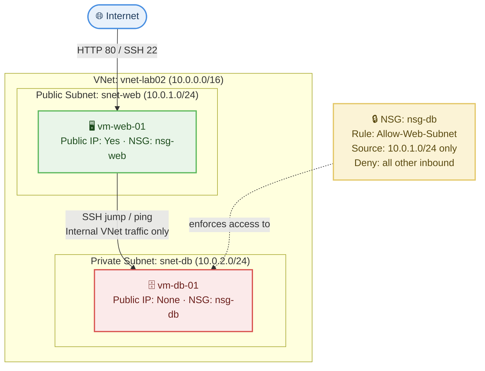

# 🔐 Lab 02: Building a Secure 2-Tier Web Application

**Author:** Adam Austin | **Estimated Time:** ⏱️ 60 Minutes | **Difficulty:** 🟢 Beginner

---

## 📋 Objective

Build a classic **IaaS architecture** on Azure. Create a Virtual Network with two subnets — a **Public** subnet for a Web Server and a **Private** subnet for a Database Server. Configure Network Security Groups (NSGs) to ensure the Database Server is protected from the internet and only accessible by the Web Server.

---

## 🏗️ Architecture



---

## 📐 Lab Variables (Naming Convention)

| Resource | Value |
|---|---|
| Resource Group | `rg-lab02-[yourname]` |
| VNet Name | `vnet-lab02` |
| Subnet 1 (Public) | `snet-web` — `10.0.1.0/24` |
| Subnet 2 (Private) | `snet-db` — `10.0.2.0/24` |
| Web VM | `vm-web-01` |
| Database VM | `vm-db-01` |

---

## 🚀 Step-by-Step Instructions

### Phase 1: 🌐 The Network Foundation

1. Search for **Virtual Networks** → **Create**
2. **Basics:**
   - Resource Group: Create New → `rg-lab02-[yourname]`
   - Name: `vnet-lab02`
   - Region: `East US`
3. **IP Addresses:**
   - Address Space: `10.0.0.0/16`
   - Subnet 1 — Name: `snet-web`, Range: `10.0.1.0/24`
   - Subnet 2 — Name: `snet-db`, Range: `10.0.2.0/24`
4. Click **Review + create** → **Create**


---

### Phase 2: 🖥️ Deploying the Web Server (Front End)

1. Search for **Virtual Machines** → **Create**
2. **Basics:**
   - Resource Group: `rg-lab02-[yourname]`
   - Name: `vm-web-01`
   - Region: `East US`
   - Image: `Ubuntu Server 20.04 LTS`
   - Size: `Standard_B1s`
   - Key pair name: `key-lab02`
   - Public inbound ports: Allow selected → **HTTP (80)** and **SSH (22)**
3. **Networking:**
   - Subnet: `snet-web`
   - Public IP: Create New (Standard)
4. Click **Review + create** → **Create**
5. 💾 Download the Private Key (`.pem`) if prompted
---

### Phase 3: 🗄️ Deploying the Database Server (Back End)

1. Create another **Virtual Machine**
2. **Basics:**
   - Resource Group: `rg-lab02-[yourname]`
   - Name: `vm-db-01`
   - Region: `East US`
   - Image: `Ubuntu Server 20.04 LTS`
   - Size: `Standard_B1s`
   - Key pair name: Use existing → `key-lab02`
   - Public inbound ports: Allow selected → **SSH (22)**
3. **Networking** ⚠️ *Critical Step:*
   - Virtual Network: `vnet-lab02`
   - Subnet: `snet-db`
   - Public IP: **None** ← This server must not be internet-facing
4. Click **Review + create** → **Create**


---

### Phase 4: 🔁 Validating Connectivity (The Jump)

Since `vm-db-01` has no public IP, you cannot connect to it directly. You must **jump through the Web Server**.

**Step 1 — Get the DB Server's Private IP:**
> Navigate to `vm-db-01` → look for **Private IP address** (should be `10.0.2.4`)

**Step 2 — SSH into the Web Server:**
```bash
ssh -i key-lab02.pem azureuser@<public-ip-of-web>
```

**Step 3 — Test internal connectivity from the Web Server:**
```bash
ping 10.0.2.4
```

✅ You should see replies — this confirms both VMs are connected inside the VNet.  
Press `Ctrl + C` to stop.


---

### Phase 5: 🔒 Configuring the Firewall (NSG)

Restrict `vm-db-01` so **only** the Web Subnet can communicate with it.

1. Go to the **Networking** tab of `vm-db-01`
2. Click the **Network Security Group** (e.g., `vm-db-01-nsg`)
3. Click **Inbound security rules** → **+ Add**
4. Configure the rule:

| Setting | Value |
|---|---|
| Source | IP Addresses |
| Source IP / CIDR | `10.0.1.0/24` |
| Source port ranges | `*` |
| Destination | Any |
| Service | Custom |
| Destination port ranges | `*` (or `3306` / `5432` if DB is installed) |
| Action | **Allow** |
| Priority | `100` |
| Name | `Allow-Web-Subnet` |

5. Click **Add**

> 💡 Because `vm-db-01` has no public IP, internet traffic is already blocked. This rule makes the intent **explicit** and enforced at the NSG layer.


---

## 🛠️ Troubleshooting

| Issue | Fix |
|---|---|
| 🔴 Ping fails | Verify `vm-db-01` is deployed into `snet-db`. Confirm both VMs are in `vnet-lab02`. |
| 🔴 Can't SSH into `vm-db-01` | You can't connect directly — no public IP. SSH into `vm-web-01` first, then jump to the DB. (Copying your `.pem` to the Web server is an advanced topic.) |

---

## 🧹 Clean Up

Delete the resource group to avoid charges:

```bash
az group delete --name rg-lab02-[yourname] --yes --no-wait
```

Or navigate to `rg-lab02-[yourname]` in the portal → **Delete resource group**.

---

*Lab completed as part of Azure cloud engineering portfolio — [austindevstudio](https://github.com/austindevstudio)*
